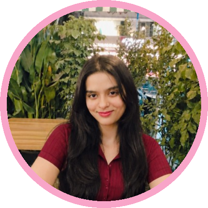

  

   

  

  

 

[About](#about) &nbsp;|&nbsp; [Skills](#skills) &nbsp;|&nbsp; [Projects](#featured-projects) &nbsp;|&nbsp; [GitHub Stats](#github-stats) &nbsp;|&nbsp; [Achievements](#certifications-and-achievements) &nbsp;|&nbsp; [Contact](#connect-with-me)

---

## About
## About Me

Hi! I'm Rutvi Landge, a Computer Engineering undergraduate and aspiring Full Stack Developer passionate about building modern, scalable web applications and AI-powered solutions.

I enjoy working across the entire software development lifecycle — transforming ideas into functional applications by designing responsive user interfaces, developing backend services, integrating databases, and building intelligent features using Artificial Intelligence and Large Language Models (LLMs).

My technical interests include Full Stack Developmentwith React.js, Next.js, TypeScript, Node.js, and Express.js; Backend Engineering with Java, Spring Boot, and RESTful APIs; and Database Management using PostgreSQL, MySQL, MongoDB, Supabase, and Neon.

I'm also interested in Artificial Intelligence and Machine Learning, particularly LLMs, Retrieval-Augmented Generation (RAG), AI agents, Gemini API, Ollama, and vector search. Alongside development, I focus on writing secure applications through authentication, authorization, JWT, and OAuth 2.0.

I continuously strengthen my programming fundamentals, particularly Data Structures and Algorithms using C++, through consistent problem-solving on LeetCode. I enjoy learning new technologies, experimenting with ideas, and building practical solutions to real-world engineering problems.

---

## Skills

**Languages**

**Frontend**

**Backend**

**Databases & ORM**

**AI & Machine Learning**

**Security & Tools**

**CS Fundamentals:** DSA &bull; OOP &bull; DBMS &bull; OS &bull; CN

---

## Featured Projects

<table>
<tr>
<td width="50%" valign="top">

<h3>EchoNote</h3>

AI-powered meeting assistant designed to help capture, organize, and retrieve meeting knowledge.

</td>
<td width="50%" valign="top">

<h3> MedIntel AI</h3>

An AI-powered healthcare intelligence project focused on applying artificial intelligence to healthcare-related challenges.

</td>
</tr>
<tr>
<td width="50%" valign="top">

<h3> CODEXA</h3>

AI-powered cloud coding workspace featuring project management, an integrated code editor, terminal, Git workflows, and an AI coding assistant.

</td>
<td width="50%" valign="top">

<h3> VeriLens</h3>

A full-stack verification platform built with a structured backend and modern web technologies.

</td>
</tr>
<tr>
<td width="50%" valign="top">

<h3>NEXUS</h3>

Voice-enabled personal AI assistant combining conversational AI, personal context, and agentic workflow orchestration.

</td>
<td width="50%" valign="top">

<h3> QUANTARA</h3>

Conversational AI analytics platform that transforms natural-language questions into SQL queries, dashboards, and data insights.

</td>
</tr>
<tr>
<td width="50%" valign="top">

<h3> GitNova</h3>

A software development project exploring GitHub-focused tooling and developer workflows.

</td>
<td width="50%" valign="top">

<h3>SYNAPTRA</h3>

An AI-focused project exploring knowledge retrieval and intelligent information access.

</td>
</tr>
<tr>
<td width="50%" valign="top">

<h3>AETHERIS</h3>

An AI-focused project exploring video intelligence and computer vision applications.

</td>
<td width="50%" valign="top">

<h3> More on GitHub</h3>

Explore my repositories, experiments, and development work.

</td>
</tr>
</table>

## GitHub Stats

---

## Certifications and Achievements

**Achievements**

- Secured 2nd Rank in Third Year Computer Engineering
- Published a research paper in IJRASET on AI-based visual defect detection in automotive manufacturing
- Solved 200+ LeetCode problems

**Certifications**

- Infosys: Data Analysis with Python
- freeCodeCamp: Machine Learning
- JPMorgan Chase: Software Engineering Job Simulation
- IBM: Data Fundamentals
- TCS: AI Foundation

---

## Connect With Me

- GitHub: [github.com/rutvilandge](https://github.com/rutvilandge)
- LinkedIn: [Rutvi Landge](https://www.linkedin.com/in/rutvi-landge-9988413b0/)
- Email: [rutvilandge@gmail.com](mailto:rutvilandge@gmail.com)
- LeetCode: [leetcode.com/u/rutvil](https://leetcode.com/u/rutvil/)

